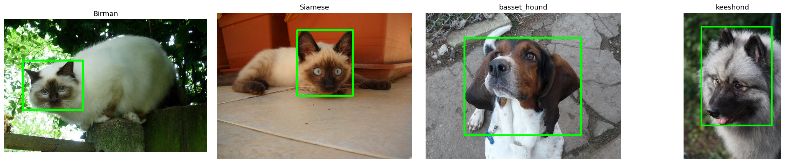

# Лабораторная 1: Среда, репозиторий и первый взгляд на данные

## 1. Задача

Изучить изображения и разметку своего варианта, проверить чтение и базовые преобразования изображений через OpenCV, собрать сводку по файлам.

## 2. Как запустить

Откройте `solution.ipynb` в Colab или Kaggle, проверьте `VARIANT = 2` в первой ячейке и выполните Run All. Зависимости указаны в `requirements.txt`. Ноутбук запускался локально; результаты сохранены в `results/`.

## 3. Данные

Вариант 02:  "Birman": "бирманская кошка (священная бирма)",
    "Siamese": "сиамская кошка",
    "basset_hound": "бассет-хаунд",
    "keeshond": "кеесхонд (вольфшпиц)". В наборе 800 изображений, 400 XML-бокса и 800 trimap-масок.

## 4. Результаты

Полная сводка: [summary.csv](Results/summary.csv).

| Показатель | Значение |
| --- | ---: |
| Файлов | 800 |
| Пород | 4: 2 кошачьи, 2 собачьи |
| Изображений кошек / собак | 400 / 400 |
| Ширина, min / медиана / max | 194 / 500 / 1200 px |
| Высота, min / медиана / max | 196 / 375 / 900 px |
| Не в режиме RGB | 0 |
| `.jpg`, но не JPEG | 0 |
| С XML-боксом | 400 (50%) |
| С trimap-маской | 800 |

Преобразования: [transforms.png](Results/transforms.png).

## 5. Выводы

- Породы представлены почти поровну: по 200 изображения у British Shorthair, Russian Blue и beagle, 200 у leonberger.
- Все 800 файлов — JPEG в режиме RGB; файлов с несовпадающим форматом или режимом нет.
- XML-бокс есть у 400 из 800 изображений (50%), поэтому боксы покрывают только часть набора.
- Медианный размер кадра — 500×375 px; преобразование к 224×224 без сохранения пропорций растягивает изображение.
